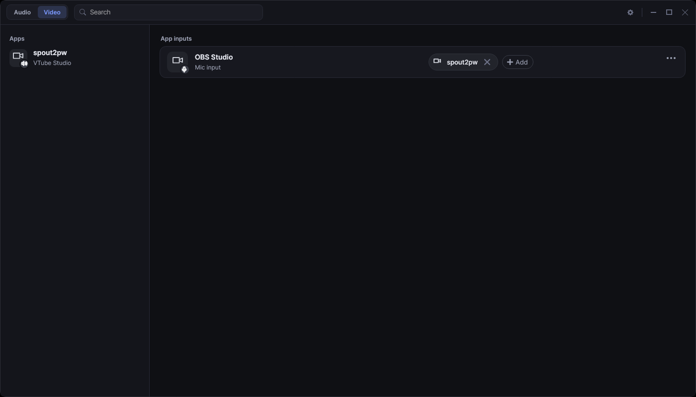

# AutoRoute

[](https://git.bussy.cloud/jessie/AutoRoute/actions?workflow=ci.yml)

AutoRoute keeps your PipeWire routing the way you set it. Send Spotify to a music sink, a game to
a sink OBS captures, Discord to your headset, and those links come back every time the apps
restart. Links you remove stay removed, even when WirePlumber tries to put its default link back.

It runs in the tray on Linux, with a window for setting up routes.


## Why

PipeWire gives a node a new ID every time it appears, so a link you make by hand is gone the next
time the app starts. If you split game, music and voice into separate virtual sinks, that means
re-patching after every launch. AutoRoute remembers routes by app and output instead of by ID, and
puts them back whenever the graph changes.

## What it does

- Routes apps, mics and sink monitors to outputs, and keeps those routes across app restarts and
  reboots. One source can feed several outputs.
- Keeps removed routes removed.
- Creates virtual sinks and recreates them at boot, even when AutoRoute isn't running. An existing
  `virtual-sinks.conf` gets imported.
- Volume faders with live level meters for apps, outputs and inputs. The meters only run while the
  window is open.
- Shows each node's sample rate and bit depth.
- Routes video the same way, for example a Spout2PW sender into OBS.
- Only removes links it made, or ones you removed. Anything else you patch by hand is left alone,
  and nodes marked Hands off (an EasyEffects chain, say) aren't touched at all.

## Install

**AppImage:** download `AutoRoute-*-x86_64.AppImage` from the
[releases](https://git.bussy.cloud/jessie/AutoRoute/releases), make it executable and run it. It
updates itself from the ⬇ button in the bottom bar, or with `AutoRoute --check-update`.

**Arch:** [`autoroute`](https://aur.archlinux.org/packages/autoroute) on the AUR.

```bash
paru -S autoroute
```

The package uses the system `dotnet-runtime-10.0`, installs a desktop entry and a systemd user
unit, and gets its updates through pacman. The PKGBUILD is in [`packaging/aur/`](packaging/aur/PKGBUILD).

**From source,** with the [.NET 10 SDK](https://dotnet.microsoft.com/download):

```bash
git clone https://git.bussy.cloud/jessie/AutoRoute.git
cd AutoRoute
dotnet run --project src/AutoRoute.App
```

You need PipeWire with WirePlumber (`pw-dump`, `pw-link` and `pw-mon` on your `PATH`), and `pactl`
for virtual sinks.

## Using it

Each output gets a row, and the chips on a row are the sources playing into it.

- Drag a source onto a row to route it there, or use the row's **Add** button. Drop it on more rows
  to send it to several places.
- Click **✕** on a chip to remove that route. Undo shows up for a few seconds.
- Links that were already there show up amber with a **Keep** button. Keep the ones you want back
  after a restart; right-click for the other options.
- **+ Virtual sink** in the top bar makes a new virtual output.
- Click a source to see which outputs it feeds.
- The **Auto-route** switch, in the top bar and the tray menu, pauses AutoRoute.

Saved routes stay on the board while they aren't live: faded when the app isn't running, and under a
Disconnected row when the device is unplugged. Settings (⚙ in the bottom bar) has a compact layout
and Start at login.

Changes save as you make them, to `~/.config/autoroute/rules.json`.

### Video

PipeWire carries video too. Switch the top bar to **Video** to route video sources, like a
[Spout2PW](https://github.com/SimplyJustJessie/spout2pw) sender from VTube Studio, into OBS's
PipeWire Video Capture. Both apps need to be running the first time you connect them. After that,
the link comes back whenever both are up.



## Autostart

Turn on **Start at login** in Settings. It adds an entry to `~/.config/autostart` that points at
wherever AutoRoute is installed, AppImage included.

Without a desktop session, use the systemd user unit. It runs `~/.local/bin/AutoRoute --background`,
so put the binary there first, or a symlink to the AppImage. [`dist/README.md`](dist/README.md)
has the details.

```bash
systemctl --user enable --now autoroute.service
```

Flags: `--background` starts in the tray with no window, and `--poll` polls `pw-dump` instead of
watching `pw-mon`.

## How it works

When `pw-mon` reports a change, AutoRoute reads the graph with `pw-dump`, compares it with your
rules, and runs only the `pw-link` calls needed to match them. Links it creates carry an
`autoroute.managed` property, which is how it tells its own links from yours. Virtual sinks are
loaded with `pactl` and written to a `pipewire-pulse` drop-in, so they exist at boot.

```
src/AutoRoute.PipeWire/   # pw-dump, pw-link and pw-mon, the graph model, level meters
src/AutoRoute.Engine/     # rule matching, the reconciler, rules.json
src/AutoRoute.App/        # Avalonia UI, tray, background host
tests/AutoRoute.Tests/    # xUnit tests
```

Written in C# on .NET 10 with [Avalonia](https://avaloniaui.net/). Design notes are in
[`CONTEXT.md`](CONTEXT.md) and [`docs/adr/`](docs/adr/).

## License

[MIT](LICENSE)
