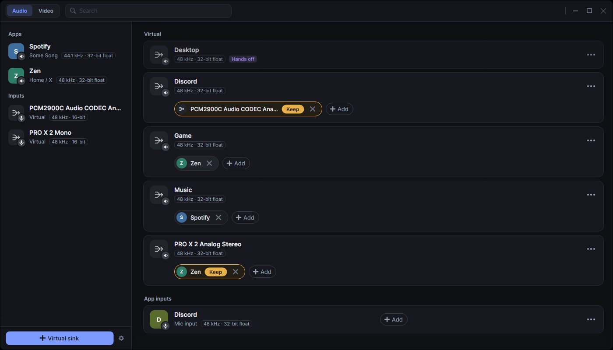
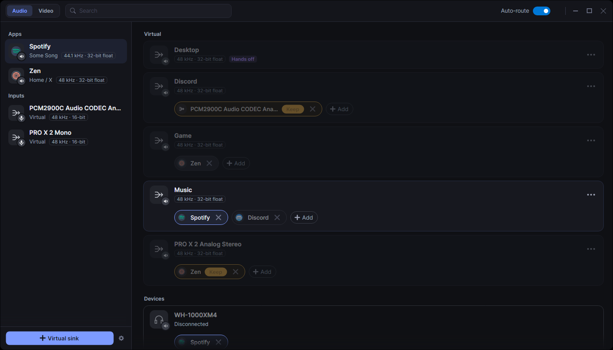

# AutoRoute

[](https://git.bussy.cloud/jessie/AutoRoute/actions?workflow=ci.yml)

**Wire your PipeWire audio once, and keep it wired.**

AutoRoute is a background service and GUI for Linux that remembers your PipeWire connections and re-applies them as apps come and go. It's a *persistent* [Helvum](https://gitlab.freedesktop.org/pipewire/helvum): you patch things the way you want, and AutoRoute keeps them that way — even though PipeWire hands out fresh node IDs every time an app restarts.



## The problem

By default WirePlumber routes every app to your default output. The moment you run separate virtual sinks — a `GameSink` feeding OBS, a `MusicSink`, a `DiscordSink` — you're back in Helvum re-patching by hand, because node IDs change on every launch and streams like Discord's per-call recording input reappear constantly. And those sinks themselves used to be a static config file you hand-edited and hoped survived the next PipeWire restart.

AutoRoute makes those patches stick, in **both directions**:

- A connection you make is **re-created** whenever the matching apps come back.
- A connection you remove **stays** removed — even when WirePlumber tries to re-add its default link.

## Features

- **Rules that survive relaunches** — connections are matched by application, not by throwaway node IDs.
- **Virtual sinks you own** — create and delete null sinks (`GameSink`, `MusicSink`, …) right from the board. AutoRoute keeps them alive across PipeWire restarts and recreates them at boot even when it isn't running, via a generated `pipewire-pulse` drop-in. No more hand-edited config files. Existing `virtual-sinks.conf` setups are detected and imported.
- **Fan-out** — send one source to several sinks at once (your headset *and* a capture sink for streaming).
- **Keep-connected and keep-disconnected** — positive rules hold a link open; suppressions keep it closed on every cycle.
- **Protected nodes** — mark routing that another tool owns (e.g. an EasyEffects chain) as off-limits, and AutoRoute won't touch it. Precedence is absolute: *protected > suppression > connect*.
- **A board, not a patchbay** — one row per output (virtual sinks, devices, app inputs), with the sources feeding it as chips. Drag a source onto a row to connect it, or use **+ Add**; drop it on several rows to fan out. Channels are paired for you. Real device names, app icons from your icon theme, and a mic stays visibly a mic. Two layouts: Comfortable (sources in a sidebar) and Compact (one-line rows, sources in a tray), switched in Settings.
- **Volume and live levels** — every app, output and input has a fader that doubles as a level meter, and a playing indicator that moves with the sound. The meters only run while the window is visible.
- **Undo, and nothing hidden** — removing a route offers Undo for a few seconds. Saved routes stay visible when they aren't live: a faded chip when the app isn't running, a *Disconnected* row when the device is unplugged. Click a source to highlight the outputs it feeds.
- **Sample rate & bit depth at a glance** — every source and sink wears a small badge showing what it's running at (e.g. `48 kHz · 24-bit`, `44.1 kHz · 32-bit float`), read straight from the live graph.
- **Video too, same rules** — PipeWire carries video, so the board has an **Audio / Video** switch in the top bar. Route a Spout2PW sender (VTube Studio, an overlay, …) into OBS's PipeWire Video Capture exactly the way you route audio, and stop re-connecting it by hand every session.
- **Runs in the background** — a tray app (and an optional systemd service) reconcile the graph continuously; closing the window just hides it.
- **Non-destructive** — AutoRoute only ever removes links it created or ones you explicitly suppressed. Your other manual patches are never touched.

## Requirements

- Linux with **PipeWire** and **WirePlumber** (`pw-dump`, `pw-link`, `pw-mon` available on your `PATH`)
- `pactl` (from `libpulse`) for the virtual-sink features
- The [**.NET 10 SDK**](https://dotnet.microsoft.com/download) — only to build from source; the AppImage and the AUR package don't need it

## Install

**AppImage** (no .NET required): grab `AutoRoute-*-x86_64.AppImage` from the latest
[release](https://git.bussy.cloud/jessie/AutoRoute/releases) (or the `AutoRoute-AppImage`
artifact on any CI run), `chmod +x` it, run it. Built by `scripts/build-appimage.sh`.
Once running, an AppImage keeps itself current: the ⬇ button checks the Gitea releases for
a newer version and installs it in place (download → checksum + boot self-test → atomic swap →
restart). `AutoRoute --check-update` is the headless equivalent.

**Arch (AUR)**: [`autoroute`](https://aur.archlinux.org/packages/autoroute) — build it with your
AUR helper of choice:

```bash
paru -S autoroute
```

It builds framework-dependent against `dotnet-runtime-10.0`, so .NET security updates arrive
through pacman rather than being frozen into the package. The PKGBUILD lives in
[`packaging/aur/`](packaging/aur/PKGBUILD). A pacman install gets `/usr/bin/autoroute`, a desktop
entry, and a `systemd --user` unit (see [Autostart](#autostart)); the in-app updater stays inert
there, since pacman owns the files.

**From source:**

```bash
git clone https://git.bussy.cloud/jessie/AutoRoute.git
cd AutoRoute
dotnet build
```

## Run

```bash
dotnet run --project src/AutoRoute.App              # open the window
dotnet run --project src/AutoRoute.App -- --background   # tray only, no window
```

Flags:

- `--background` — start hidden (tray only)
- `--poll` — poll `pw-dump` for changes instead of watching `pw-mon`

## Using it

1. Launch AutoRoute — the board mirrors your current audio graph. Links that already exist show up as amber chips with **Keep**: keep one to have it restored after a restart, or right-click for *Leave as is*. A brand-new setup is offered a few ready-made sets of virtual outputs to start with.
2. Hit **+ Virtual sink** to create a virtual output (name, description, stereo or mono). It is recreated on every boot; deleting it from its row's **⋯** menu also cleans up any rules pointing at it.
3. Drag a source (an app, a microphone, or an output's monitor) onto an output's row to connect it, or use the row's **+ Add**. Drop it on more rows to fan out.
4. Remove a chip with **✕** to disconnect (Undo is offered for a few seconds). Removing a link someone else made records a **suppression** so it stays gone.
5. Mark an output or source **Hands off** to tell AutoRoute to leave it and everything touching it alone.
6. The **Auto-route** switch in the top bar (and the tray) pauses AutoRoute entirely; flip it back on and it catches up.



Rules are written to `~/.config/autoroute/rules.json` the moment you make a change — there is no Save button.

### The Video tab

PipeWire carries video alongside audio, and the same "the IDs changed, re-patch it by hand" problem
applies — which is why reconnecting VTube Studio to OBS becomes a ritual every time you start them.
The **Video** switch in the top bar shows the video half of the graph: video sources
(a [Spout2PW](https://github.com/SimplyJustJessie/spout2pw) sender, a screen-capture stream) and the
video inputs they can feed, one row each (OBS's *PipeWire Video Capture* source).


It works exactly like the audio board: drag a source onto a row once, and the link is re-created
every time both apps come back. The rules live in the same `rules.json` and are re-applied by the
same background reconciler — there is nothing extra to configure or enable.

Both apps have to be running for their nodes to exist, so start VTube Studio (with Spout2PW) and OBS
first, then make the connection once. Virtual-sink creation is audio-only, so **+ Virtual sink** is
hidden on this tab.

## Autostart

**Easiest:** open the ⚙ menu (bottom bar) and flip **Start at login**. AutoRoute
detects its own path (the AppImage included — no symlink, no hand-edited unit) and adds a desktop
autostart entry (`~/.config/autostart`). Your desktop launches it as part of your session, so it
inherits the display and tray environment a GUI app needs. Flip it off to remove it.

**By hand (headless / no desktop):** a systemd user service is also included, for setups without a
graphical session to autostart it. It launches `~/.local/bin/AutoRoute --background`,
so first make that name exist — publish the binary there **or**, if you use the AppImage, symlink it
(`ln -sf ~/Apps/AutoRoute-x86_64.AppImage ~/.local/bin/AutoRoute`). Full steps for both, plus an
XDG-autostart alternative, are in [`dist/README.md`](dist/README.md). Then:

```bash
systemctl --user enable --now autoroute.service
journalctl --user -u autoroute -f     # follow its logs
```

The unit lives at [`dist/systemd/autoroute.service`](dist/systemd/autoroute.service).

## How it works

AutoRoute reads the graph from `pw-dump`, matches it against your rules, and makes only the `pw-link` changes needed to reach the state you asked for — an idempotent reconcile that runs whenever the graph or your rules change. Each cycle first ensures your declared virtual sinks exist (loading them with `pactl` and writing a `pipewire-pulse` conf.d drop-in for boot persistence), then reconciles the links. Every link it creates is tagged `autoroute.managed`, so it can always tell its own links from yours and never cleans up a connection it didn't make. `pw-mon` tells it *when* to re-check; it never routes by name, only by numeric port ID.

```
src/AutoRoute.PipeWire/   # PipeWire interop: graph model + pw-dump/pw-link/pw-mon drivers
src/AutoRoute.Engine/     # rule matching, the reconciler, and rules.json persistence
src/AutoRoute.App/        # Avalonia MVVM board UI, tray, and the always-on host
tests/AutoRoute.Tests/    # xUnit test suite
```

Built with C# / .NET 10 and [Avalonia](https://avaloniaui.net/).

## Design notes

The reasoning behind the architecture is written down in the repo:

- [`PLAN.md`](PLAN.md) — the v1 build spec
- [`PLAN.v2.md`](PLAN.v2.md) — the v2 build spec (app-managed virtual sinks)
- [`CONTEXT.md`](CONTEXT.md) — the project's vocabulary
- [`docs/adr/`](docs/adr/) — architecture decision records

## License

[MIT](LICENSE)
